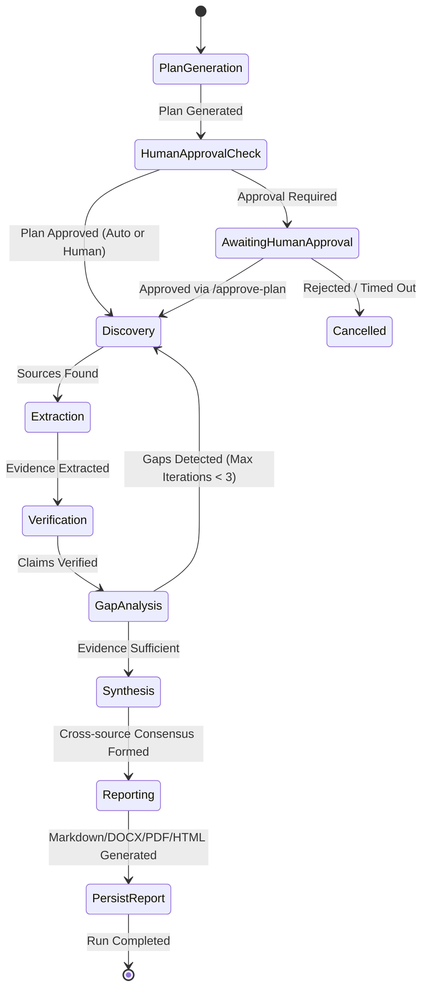

# ResearchForge System Architecture Specification

**Document Version:** 1.0.0  
**Last Updated:** November 2026  
**Status:** Approved  

---

## 1. System Topology Overview

ResearchForge is an agentic AI research platform constructed around a **dual-service backend architecture** connected to a unified **Neon PostgreSQL** database with `pgvector` indexing.

```
+-----------------------------------------------------------------------------------------+
|                                    Client Tier                                          |
|  Next.js 14+ Frontend (React, Tailwind CSS, Lucide Icons, React Flow, Recharts)         |
+-----------------------------------------------------------------------------------------+
                                 |                                  |
              Client REST APIs   |                                  | SSE Progress Stream
              (JSON over HTTPS)  |                                  | (text/event-stream)
                                 v                                  v
+-----------------------------------------------------------------------------------------+
|                                Node.js API Gateway                                      |
|  - Express.js Application Server (Port 5000)                                            |
|  - Better Auth (OAuth 2.0 Google/GitHub + Email/Password sessions)                      |
|  - Multi-tenant Workspace Scoping & RBAC (OWNER, ADMIN, MEMBER, VIEWER)                 |
|  - Rate Limiting Middleware (Sliding window: General, Auth, Research tiers)             |
|  - Prisma ORM (Exclusive owner of PostgreSQL migrations & schema)                       |
|  - Resilient SSE Proxy (Forwarding AI Engine events with automatic database fallback)   |
|  - Centralized Error Handling & Recursive Secret Sanitization                           |
+-----------------------------------------------------------------------------------------+
                                 |                                  ^
          Internal Control &     |                                  | Async Status Callbacks
          Trigger Requests       | (X-Internal-Service-Key)         | & Error Notifications
                                 v                                  |
+-----------------------------------------------------------------------------------------+
|                                Python AI Engine                                         |
|  - FastAPI Microservice (Port 8000)                                                     |
|  - LangGraph Multi-Agent State Machine (Planner, Discovery, Extraction,                 |
|                                         Verification, Synthesis, Reporting)             |
|  - Model Context Protocol (MCP) Client Manager (Tavily, Exa, Firecrawl, GitHub)         |
|  - Dynamic LangGraph Checkpointing & State Persistence                                  |
|  - Hybrid RAG Pipeline & Scoped Memory (User, Workspace, Project scopes)                |
|  - Hugging Face BAAI/bge-small-en-v1.5 Embedding Engine (384 dimensions)                |
|  - SSRF Protection, Prompt Injection Sanitizer & Unbounded Tool Output Clamper          |
|  - Atomic Monotonic Event Sequencing (`SELECT ... FOR UPDATE` row locks)               |
+-----------------------------------------------------------------------------------------+
                    |                                                     |
                    | Direct asyncpg Queries                              | Prisma Client Queries
                    v                                                     v
+-----------------------------------------------------------------------------------------+
|                              Neon PostgreSQL Database                                   |
|  - pgvector extension (Cosine distance vector indexes `vector_cosine_ops`)             |
|  - 19 Tables: User, Session, Account, Workspace, WorkspaceMember, Project,            |
|               ResearchRun, ResearchEvent, ResearchPlan, ResearchFinding,                |
|               ResearchSource, Evidence, ClaimVerification, Report, ReportCitation,      |
|               DocumentAsset, DocumentChunk, KnowledgeNode, KnowledgeEdge,               |
|               MCPToolCall, AnalyticsSummary                                             |
|  - Connection Pooling via Neon PgBouncer / direct connections                           |
+-----------------------------------------------------------------------------------------+
```

---

## 2. Core Architectural Principles

### 2.1. Separation of Concerns
1. **Node.js Gateway (`backend/node-server`)**:
   - Manages user identities, authentication cookies, session lifetimes, workspace tenancy, invitation tokens, and project lifecycle.
   - Exclusive owner of the database schema and migrations through Prisma ORM.
   - Exposes public REST endpoints to the frontend, verifying session legitimacy and workspace-level authorization prior to delegating operations.
   - Provides resilient SSE streaming: proxies the live SSE connection from the AI Engine, but automatically falls back to polling the database if the AI Engine becomes momentarily unreachable.

2. **Python AI Engine (`backend/ai-engine`)**:
   - Manages AI intelligence, LLM orchestration, agent workflows, tool execution, fact verification, and report synthesis.
   - Connects directly to Neon PostgreSQL via `asyncpg` connection pools for high-throughput reads, vector similarity searches, and appending events.
   - Operates strictly as a **data consumer**; never runs database migrations or alters schema definitions.

### 2.2. Inter-Service Security & Trust Boundary
- The Node.js Gateway and Python AI Engine communicate over HTTP using an internal pre-shared key header:
  ```http
  X-Internal-Service-Key: <INTERNAL_SERVICE_KEY>
  ```
- Any request lacking or providing an invalid key is rejected with `403 Forbidden`.
- The AI Engine validates all URLs submitted to scraping tools (e.g. Firecrawl, Exa) against an internal SSRF filter to prevent loopback, private RFC-1918, or cloud metadata access.

---

## 3. Multi-Agent Orchestration Architecture (LangGraph)

The AI Engine executes research tasks using a state graph compiled with **LangGraph**:



### 3.1. Agent Roles & Specifications
1. **Planner Agent**:
   - Analyzes research queries, extracts domain entities, decomposes objectives into sub-tasks, and produces structured research plans.
2. **Discovery Agent**:
   - Connects to search and exploration MCP servers (Tavily, Exa, GitHub) to discover relevant web, academic, and code sources.
3. **Extraction Agent**:
   - Scrapes target URLs (Firecrawl) or retrieves document text, extracting specific empirical findings and qualitative facts.
4. **Verification Agent**:
   - Analyzes extracted claims against supporting evidence, classifies claims (`VERIFIED`, `CONTRADICTED`, `UNVERIFIED`), identifies conflicting sources, and assigns confidence scores.
5. **Synthesis Agent**:
   - Evaluates whether research objectives have been satisfied, identifies evidentiary gaps, triggers additional research loops if needed, and synthesizes key themes.
6. **Reporting Agent**:
   - Formats final findings into publication-ready research reports with complete IEEE/APA citation footnotes and exports to Markdown, DOCX, PDF, and HTML.

---

## 4. RAG & Scoped Memory Architecture

ResearchForge employs a three-tier scoped memory architecture powered by `pgvector`:

```
+---------------------------------------------------------------------------------+
|                                Scoped Memory Tiers                              |
+---------------------------------------------------------------------------------+
| 1. User Scope:     Preferences, user research habits, global terminology         |
| 2. Workspace Scope: Organization research style, shared domain knowledge        |
| 3. Project Scope:  Project documents, past runs, project-specific entity graph  |
+---------------------------------------------------------------------------------+
```

### 4.1. Embedding Pipeline
- **Embedding Model**: `BAAI/bge-small-en-v1.5` (via Hugging Face API or local sentence-transformers).
- **Vector Dimension**: 384 dimensions.
- **Distance Metric**: Cosine Distance (`<=>` operator in PostgreSQL `pgvector`).
- **PostgreSQL Index**: `HNSW` or `IVFFlat` index with `vector_cosine_ops`.

### 4.2. Chunking & Ingestion Strategy
- Text files, PDFs, and scraped HTML are chunked using recursive character splitting:
  - **Chunk Size**: 500 tokens / ~2,000 characters.
  - **Chunk Overlap**: 50 tokens / ~200 characters.
  - **Metadata**: Source URL, document title, workspace ID, project ID, chunk index.

---

## 5. Model Context Protocol (MCP) Integration Layer

ResearchForge adheres to the official **Model Context Protocol (MCP)** specification:

```
                      ┌───────────────────────────────────────┐
                      │    AI Engine MCP Client Manager       │
                      │  - Dynamic Server Discovery           │
                      │  - Tool Registry & Input Validation   │
                      │  - SSRF Verification Guard            │
                      │  - Output Clamping (50,000 char max)  │
                      └───────┬──────────────┬──────────────┬─┘
                              │              │              │
                    ┌─────────▼──┐     ┌─────▼──────┐   ┌───▼────────┐
                    │ Tavily MCP │     │  Exa MCP   │   │ Firecrawl  │
                    │  (Search)  │     │  (Neural)  │   │  (Scrape)  │
                    └────────────┘     └────────────┘   └────────────┘
```

- **Tool Call Telemetry**: Every MCP tool execution is recorded in the `MCPToolCall` PostgreSQL table with input arguments, output status (`SUCCESS`, `FAILED`), duration in milliseconds, and error messages.
- **Circuit Breaking & Safety**: Output responses exceeding 50,000 characters are automatically clamped with diagnostic metadata to protect LLM context windows.

---

## 6. Real-Time Streaming & Resilience

1. **Monotonic Event Sequencing**:
   - Every research run emits structured events (`agent_thought`, `tool_call`, `source_discovered`, `finding_extracted`, `claim_verified`, `progress_update`, `run_status_changed`).
   - Events are persisted with a strictly sequential `sequence` integer (1, 2, 3...) per run.
   - Guaranteed via row-level locks on `ResearchRun` within explicit PostgreSQL transactions (`SELECT id FROM "ResearchRun" WHERE id = %s FOR UPDATE;`).
2. **Dual-Path SSE Streaming**:
   - The frontend connects to `GET /api/research/:runId/events` on the Node.js API server.
   - Node initiates an internal streaming fetch to the AI Engine's SSE endpoint (`GET /api/v1/research/:runId/events`).
   - If the AI Engine is unavailable or temporarily restarts, Node seamlessly switches to streaming pending events directly from PostgreSQL using cursor-based polling (`sequence > lastSequence`), ensuring zero dropped events.

