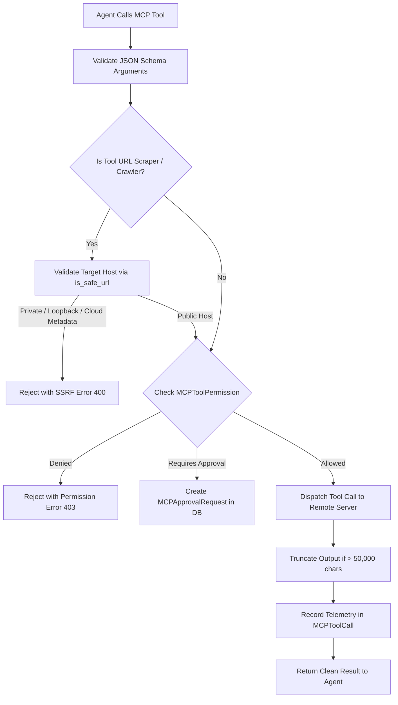

# ResearchForge Model Context Protocol (MCP) Integration Specification

**Protocol Specification:** Model Context Protocol (MCP) 2024-11-05 / Streamable HTTP & SSE  
**Client Implementation:** Python AI Engine (`backend/ai-engine/mcp`)  
**Design Pattern:** Client-Only Integration (Remote Server Federation)  

---

## 1. Overview & Architectural Philosophy

ResearchForge leverages the **Model Context Protocol (MCP)** to equip AI agents with real-time, external capabilities. Following core engineering principles, ResearchForge operates **strictly as an MCP client**, connecting to existing remote MCP servers rather than hosting custom server infrastructure.

```
                      ┌──────────────────────────────────────────┐
                      │        AI Engine MCP Client Manager      │
                      │  - Dynamic Server Connection             │
                      │  - Automated Tool Discovery              │
                      │  - SSRF Verification Guard               │
                      │  - Tool Output Clamper (50,000 char max) │
                      │  - Telemetry Logger (MCPToolCall Table)  │
                      └───────┬──────────┬──────────┬──────────┬─┘
                              │          │          │          │
                              ▼          ▼          ▼          ▼
                       ┌────────────┐ ┌─────┐ ┌──────────┐ ┌────────┐
                       │ Tavily MCP │ │ Exa │ │Firecrawl │ │ GitHub │
                       │   Search   │ │ MCP │ │ Scraping │ │  MCP   │
                       └────────────┘ └─────┘ └──────────┘ └────────┘
```

---

## 2. Integrated MCP Server Providers

| Server Provider | Transport | Default Endpoint | Primary Capabilities |
|---|---|---|---|
| **Tavily Search** | Streamable HTTP | `https://api.tavily.com/mcp` | General web queries, current events, answer extraction |
| **Exa Neural Search** | Streamable HTTP | `https://api.exa.ai/mcp` | Semantic search, academic paper filtering, content discovery |
| **Firecrawl** | Streamable HTTP | `https://api.firecrawl.dev/mcp` | Clean web scraping, HTML-to-Markdown, deep crawl |
| **GitHub** | SSE / HTTP | `https://api.github.com/mcp` | Repository inspection, commit analysis, code search |

---

## 3. Tool Discovery & Registry

When the AI Engine starts or when an administrator registers a new remote server in the `MCPServer` database table:
1. **Endpoint Handshake**: The [`MCPClientManager`](file:///C:/Arvind/Reasearch_Forge/backend/ai-engine/mcp/manager.py) connects to the remote MCP server using the configured transport (`STREAMABLE_HTTP` or `SSE`).
2. **Schema Ingestion**: Calls the MCP `tools/list` RPC method to retrieve all available tools, their JSON Schema parameters, and descriptions.
3. **Database Synchronization**: Updates the `MCPTool` table in PostgreSQL, caching parameter schemas for fast client validation.

---

## 4. Security & Safety Guardrails

All MCP tool invocations pass through an enforced security pipeline in `MCPClientManager.execute_tool`:



### 4.1. SSRF (Server-Side Request Forgery) Defense
Any tool that accepts external URLs (e.g. `firecrawl_scrape`, `exa_find_similar`) is subjected to `is_safe_url` validation:
- Resolves DNS to physical IP addresses.
- Blocks IPv4 and IPv6 loopback addresses (`127.0.0.0/8`, `::1`).
- Blocks RFC-1918 private subnets (`10.0.0.0/8`, `172.16.0.0/12`, `192.168.0.0/16`).
- Blocks cloud instance metadata endpoints (`169.254.169.254`, `metadata.google.internal`).
- Enforces strict `http` / `https` protocol compliance.

### 4.2. Tool Output Clamping & Context Protection
To prevent runaway scraping payloads from exceeding LLM context windows or causing out-of-memory crashes:
- The output payload is inspected via `truncate_tool_output`.
- Any output surpassing **50,000 characters** is clamped at the 50,000-character boundary.
- A metadata trailer is appended:
  ```json
  {
    "_truncated": true,
    "_original_length": 184290,
    "_clamped_length": 50000,
    "_notice": "[WARNING: Tool output was clamped to prevent context exhaustion.]"
  }
  ```

---

## 5. Telemetry & Execution Auditing

Every tool execution is captured in the `MCPToolCall` relational table:
- **`toolName`**: The invoked tool (e.g. `tavily_search`).
- **`serverName`**: Originating MCP server.
- **`arguments`**: Redacted JSON input arguments.
- **`status`**: Execution outcome (`SUCCESS`, `FAILED`, `CANCELLED`).
- **`durationMs`**: Latency in milliseconds.
- **`responseSize`**: Byte length of response payload.
- **`errorMessage`**: Diagnostic error message if failed.
- **`runId`**: Foreign key to associated `ResearchRun`.

This telemetry directly feeds the workspace analytics endpoints (`GET /api/analytics/mcp`).

